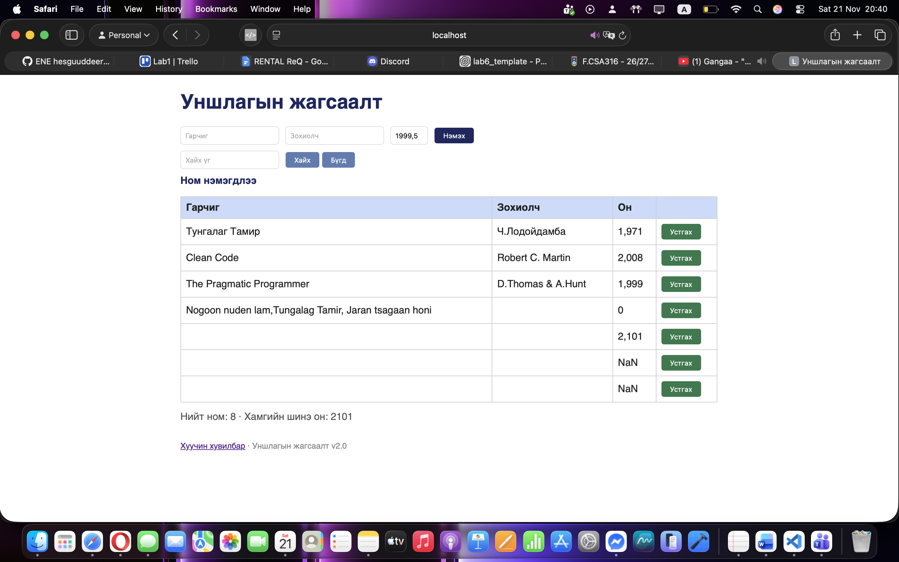
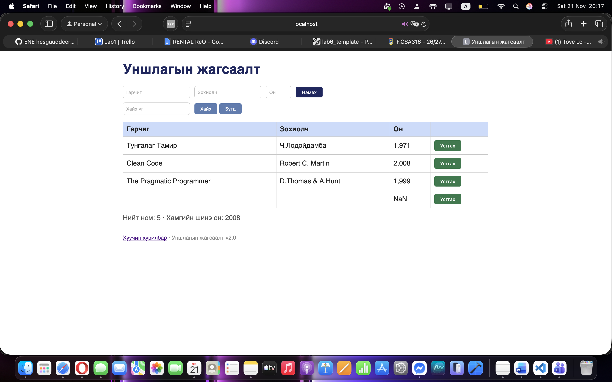

# BUG-02: Ном нэмэхэд оролтын шалгалт хийгддэггүй — хоосон талбар, муж гадуурх болон тоон бус он хүлээн авагдана

Орчин:  Уншлагын жагсаалт v2.0, Safari 26.6.2, macOS 26.6.2, 2026-11-21
Урьдчилсан нөхцөл: `node app.js`-ийг шинээр асаасан (анхны 3 ном: Тунгалаг Тамир, Clean Code, The Pragmatic Programmer)

## Дахин гаргах алхам
**A. UI-аар (хоосон талбар)**
1. `http://localhost:3000` нээ.
2. Гарчиг, Зохиолч, Он талбаруудыг хоосон орхиод **Нэмэх** дар.

**B. UI-аар (муж гадуурх он)**
3. Гарчиг, Зохиолч хоосон, Он = `2101` → **Нэмэх**.

**C. API-аар (тоон бус он)**
4. `curl -s -i -X POST localhost:3000/api/books -H 'Content-Type: application/json' -d '{"title":"","author":"","year":"abc"}'`
5. Safari-г refresh хий.

Хүлээгдэж байсан: ном нэмэгдэхгүй, ойлгомжтой алдааны мессеж (API-д 400) — спецификаци: «Гарчиг, Зохиолч, Он гурван талбар бүгд заавал… дутуу бол ном нэмэгдэхгүй, ойлгомжтой алдааны мессеж харагдана», «Он нь 1000-2100 хоорондох бүхэл тоо».
Бодит үр дүн:
- A: «Ном нэмэгдлээ» мессеж гарч, гарчиг/зохиолч хоосон, Он = `0` мөр нэмэгдсэн.
- B: ном нэмэгдэж хүснэгтэд `2,101`, доор «Хамгийн шинэ он: 2101» гэж харагдсан.
- C: `HTTP/1.1 201 Created`, `{"result":"OK","id":4}`; хүснэгтэд хоосон мөр, Он = `NaN`.
- Мөн Он = `1999,5` оруулахад `NaN` мөр нэмэгдсэн.

Ноцтой байдал: Major — утгагүй өгөгдөл жагсаалтад хадгалагдаж, тоолуур болон «Хамгийн шинэ он»-ыг ч гажуудуулна.
Хавсралт:         · [evidence/bug-02-curl.txt](../evidence/bug-02-curl.txt)
Олдсон аялал:  Saboteur (API), Couch Potato (хоосон оролт)
