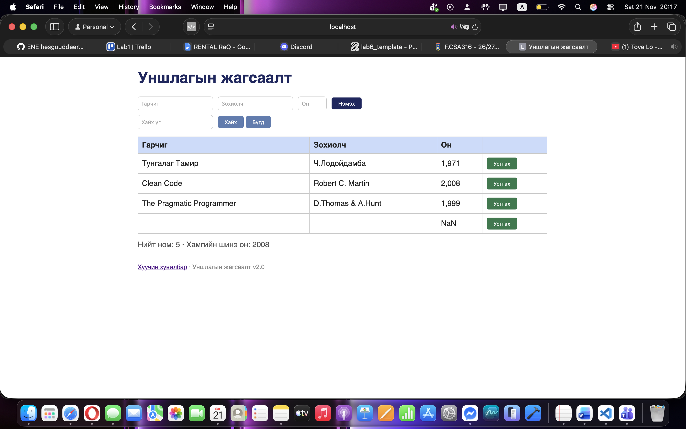

# BUG-03: Хүснэгтийн «Устгах» товч улаан биш ногоон өнгөтэй

Орчин:  Уншлагын жагсаалт v2.0, Safari 26.6.2, macOS 26.6.2, 2026-11-21
Урьдчилсан нөхцөл: `node app.js`-ийг шинээр асаасан (анхны 3 ном: Тунгалаг Тамир, Clean Code, The Pragmatic Programmer)

## Дахин гаргах алхам
1. `http://localhost:3000` нээ.
2. Хүснэгтийн мөр бүрийн баруун талын **Устгах** товчны өнгийг хар.

Хүлээгдэж байсан: улаан өнгө — спецификаци: «Аюултай үйлдлийн товч (Устгах) улаан өнгөтэй».
Бодит үр дүн:     бүх Устгах товч ногоон өнгөтэй. Ногоон нь «зөв/аюулгүй» гэсэн утга илэрхийлдэг тул хэрэглэгч эрсдэлгүй үйлдэл гэж андуурч болно (устгахаас өмнө баталгаажуулалт ч асуудаггүй).

Ноцтой байдал: Minor — функц ажилладаг ч аюулгүй байдлын харааны дохио буруу.
Хавсралт:      
Олдсон аялал:  Supermodel
