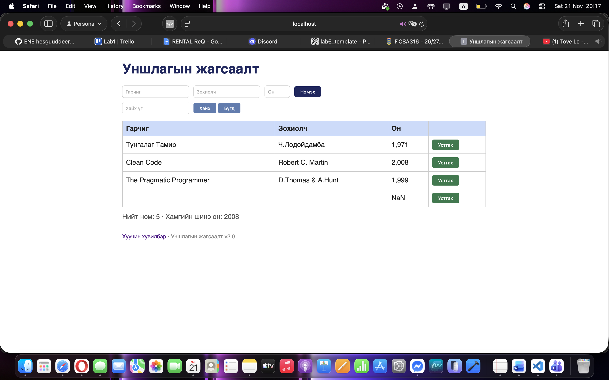

# BUG-04: Хүснэгтийн Он баганад он «1,971» гэж мянгатын таслалтай харагдана

Орчин:  Уншлагын жагсаалт v2.0, Safari 26.6.2, macOS 26.6.2, 2026-11-21
Урьдчилсан нөхцөл: `node app.js`-ийг шинээр асаасан (анхны 3 ном: Тунгалаг Тамир, Clean Code, The Pragmatic Programmer)

## Дахин гаргах алхам
1. `http://localhost:3000` нээ.
2. Хүснэгтийн **Он** баганыг хар.

Хүлээгдэж байсан: `1971`, `2008`, `1999` — спецификаци: «хүснэгтэд энгийн тоогоор (жишээ нь 1999) харагдана».
Бодит үр дүн:     `1,971`, `2,008`, `1,999`. Шинээр нэмсэн ном ч мөн адил (`1000` → `1,000`, `2100` → `2,100`).

Ноцтой байдал: Cosmetic — өгөгдөл зөв ч хэлбэржүүлэлт буруу, оныг тоо ширхэг мэт харуулна.
Хавсралт:      
Олдсон аялал:  Supermodel
