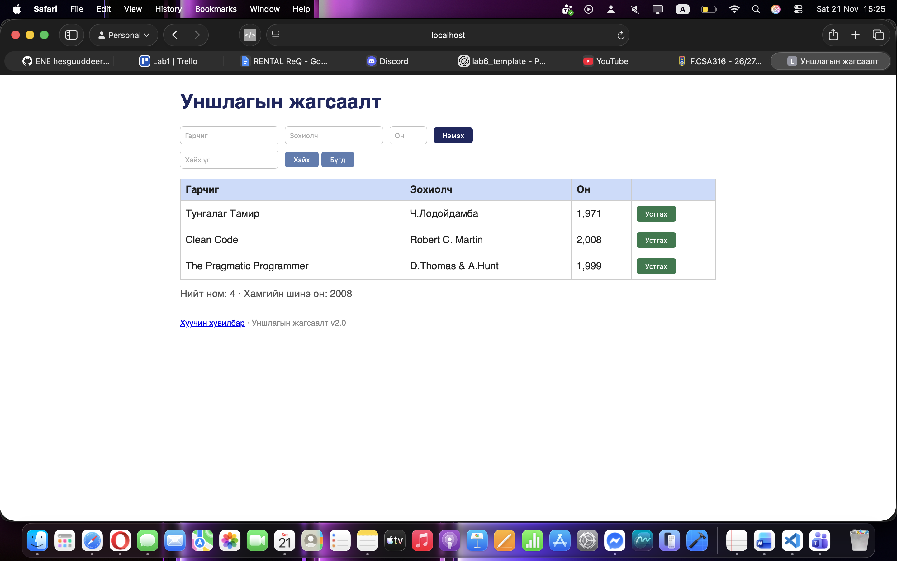
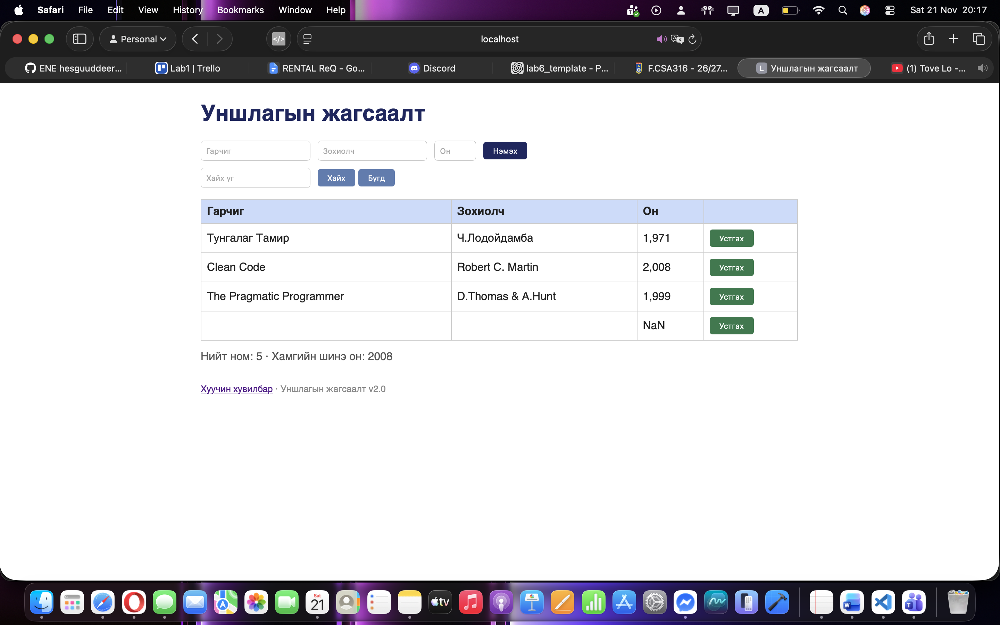
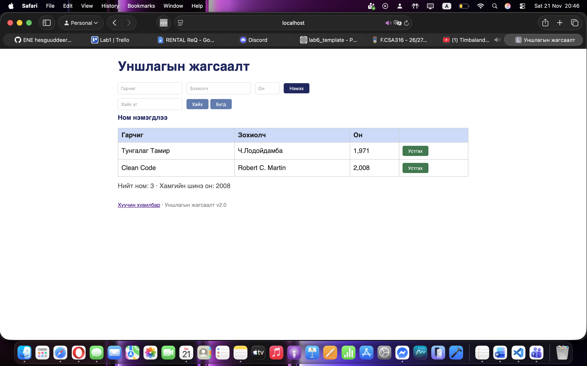

# BUG-05: «Нийт ном» тоолуур хүснэгтийн мөрийн тооноос үргэлж 1-ээр их

Орчин:  Уншлагын жагсаалт v2.0, Safari 26.6.2, macOS 26.6.2, 2026-11-21
Урьдчилсан нөхцөл: `node app.js`-ийг шинээр асаасан (анхны 3 ном: Тунгалаг Тамир, Clean Code, The Pragmatic Programmer)

## Дахин гаргах алхам
1. `http://localhost:3000` нээ.
2. Хүснэгтийн мөрийг тоол, доорх «Нийт ном: N» тоотой харьцуул.
3. (Нэмэлт) **The Pragmatic Programmer** мөрийн **Устгах**-ыг дараад дахин харьцуул.

Хүлээгдэж байсан: «Нийт ном: 3» (алхам 3-ын дараа 2) — спецификаци: «“Нийт ном” тоолуур хүснэгтэд буй номын тоотой тэнцүү».
Бодит үр дүн:     3 мөртэй байхад «Нийт ном: 4»; устгасны дараа 2 мөртэй байхад «Нийт ном: 3». Session-ий турш бүх төлөвт (4/5, 7/8, 6/7 г.м.) +1 зөрүү давтагдсан.

Ноцтой байдал: Major — хэрэглэгчид буруу тоо мэдээлэл үргэлж харагдана.
Хавсралт:        
Олдсон аялал:  Supermodel, Fed-Ex
