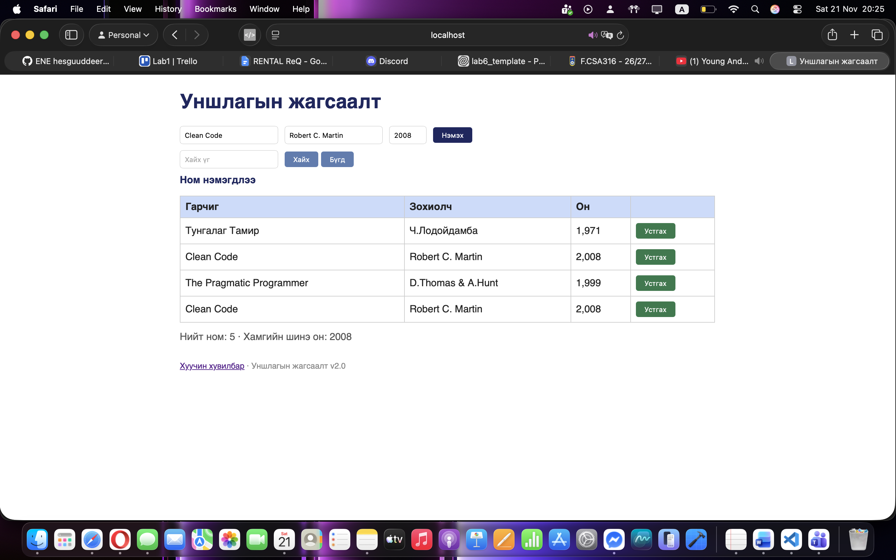

# BUG-06: Ижил гарчиг, зохиолчтой ном давхардаж нэмэгддэг

Орчин:  Уншлагын жагсаалт v2.0, Safari 26.6.2, macOS 26.6.2, 2026-11-21
Урьдчилсан нөхцөл: `node app.js`-ийг шинээр асаасан (анхны 3 ном: Тунгалаг Тамир, Clean Code, The Pragmatic Programmer)

## Дахин гаргах алхам
1. `http://localhost:3000` нээ.
2. Гарчиг = `Clean Code`, Зохиолч = `Robert C. Martin`, Он = `2008` → **Нэмэх**.

Хүлээгдэж байсан: ном нэмэгдэхгүй, давхардсан тухай мессеж — спецификаци: «Ижил гарчиг, зохиолчтой ном давхардуулж нэмэгдэхгүй».
Бодит үр дүн:     «Ном нэмэгдлээ» мессеж гарч, хүснэгтэд «Clean Code / Robert C. Martin / 2,008» хоёр дахь мөр болж нэмэгдсэн.

Ноцтой байдал: Major — жагсаалтын өгөгдлийн бүрэн бүтэн байдал алдагдана.
Хавсралт:      
Олдсон аялал:  Fed-Ex
