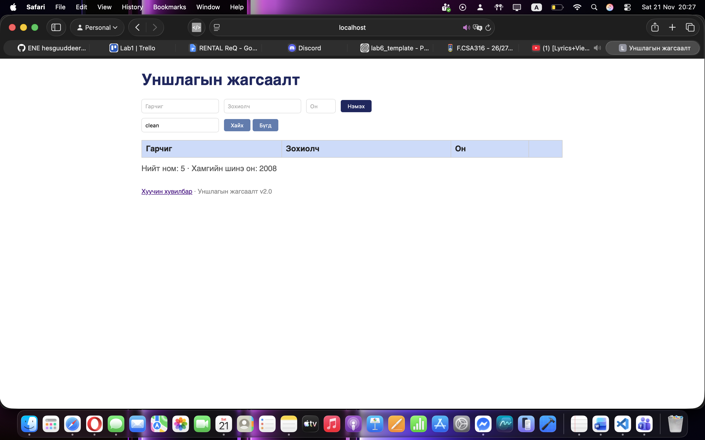
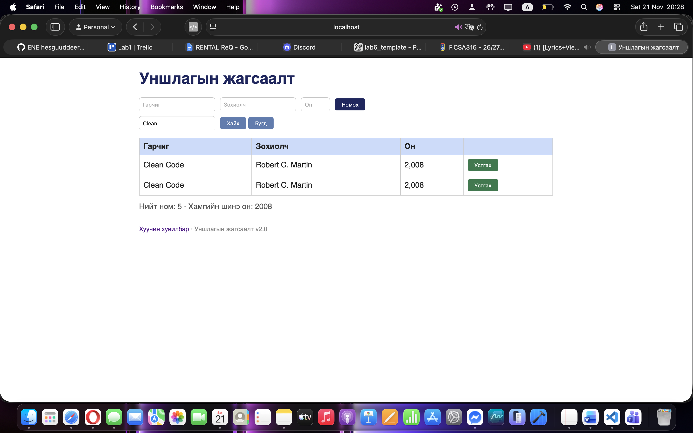
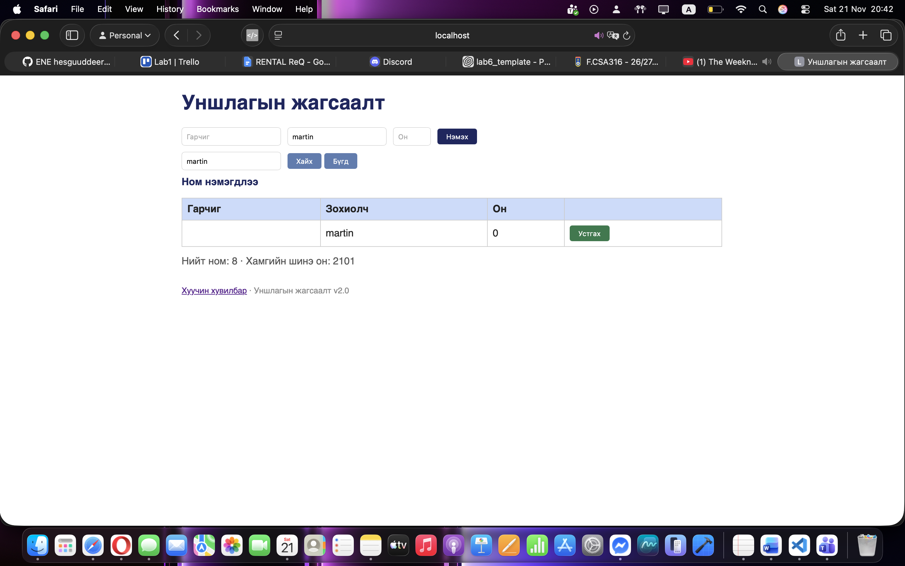

# BUG-07: Хайлт том/жижиг үсгийг ялгадаг — «clean» гэж хайхад «Clean Code» олдохгүй

Орчин:  Уншлагын жагсаалт v2.0, Safari 26.6.2, macOS 26.6.2, 2026-11-21
Урьдчилсан нөхцөл: `node app.js`-ийг шинээр асаасан (анхны 3 ном: Тунгалаг Тамир, Clean Code, The Pragmatic Programmer)

## Дахин гаргах алхам
1. `http://localhost:3000` нээ.
2. «Хайх үг» талбарт `clean` гэж бичээд **Хайх** дар.
3. **Бүгд** дараад, «Хайх үг» талбарт `Clean` гэж бичээд **Хайх** дар.
4. (Зохиолч) **Бүгд** → `martin` → **Хайх**, дараа нь `Martin` → **Хайх**.

Хүлээгдэж байсан: алхам 2 ба 3 хоёулаа «Clean Code»-ыг, алхам 4-ийн хоёр хайлт «Robert C. Martin»-ыг олно — спецификаци: «Хайлт гарчиг болон зохиолчоос хайх ба том/жижиг үсэг ЯЛГАХГҮЙ».
Бодит үр дүн:     `clean` → 0 мөр; `Clean` → Clean Code олдсон. `martin` → «Robert C. Martin» олдоогүй; `Martin` → олдсон.

Ноцтой байдал: Major — хэрэглэгч ихэвчлэн жижиг үсгээр хайдаг тул гол функц бодитоор ажиллахгүй.
Хавсралт:         
Олдсон аялал:  Fed-Ex
