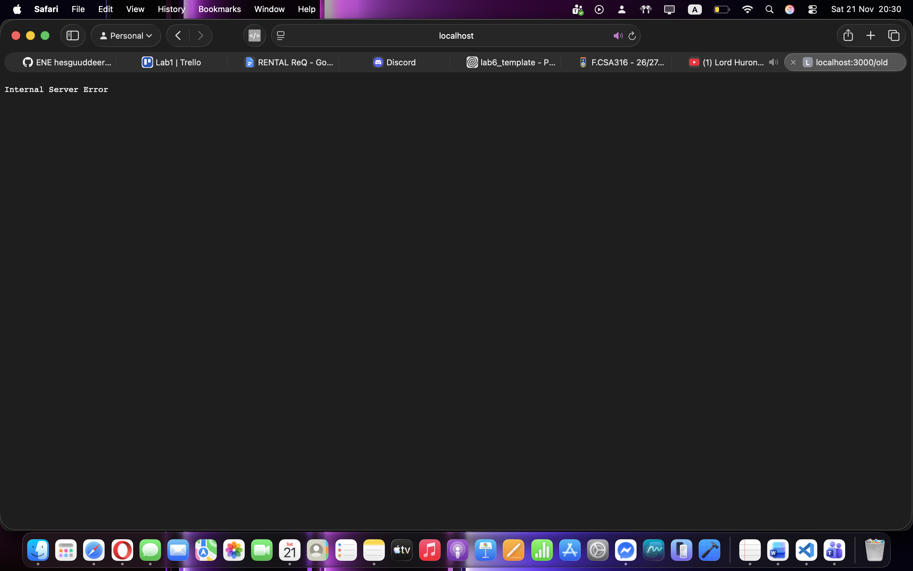

# BUG-08: «Хуучин хувилбар» линк (/old) 500 Internal Server Error буцаадаг

Орчин:  Уншлагын жагсаалт v2.0, Safari 26.6.2, macOS 26.6.2, 2026-11-21
Урьдчилсан нөхцөл: `node app.js`-ийг шинээр асаасан (анхны 3 ном: Тунгалаг Тамир, Clean Code, The Pragmatic Programmer)

## Дахин гаргах алхам
1. `http://localhost:3000` нээ.
2. Хуудасны доод талын **Хуучин хувилбар** линк дээр дар.
3. (API түвшинд) `curl -s -i localhost:3000/old`

Хүлээгдэж байсан: хуучин хувилбарын хуудас нээгдэнэ — спецификаци: «бүх хуудас, линк ажиллана».
Бодит үр дүн:     `localhost:3000/old` хуудсанд зөвхөн «Internal Server Error» текст; curl: `HTTP/1.1 500 Internal Server Error`.

Ноцтой байдал: Major — хуудасны линк серверийн алдаа үүсгэж, хэрэглэгч гацна.
Хавсралт:       · [evidence/bug-08-curl.txt](../evidence/bug-08-curl.txt)
Олдсон аялал:  Supermodel
