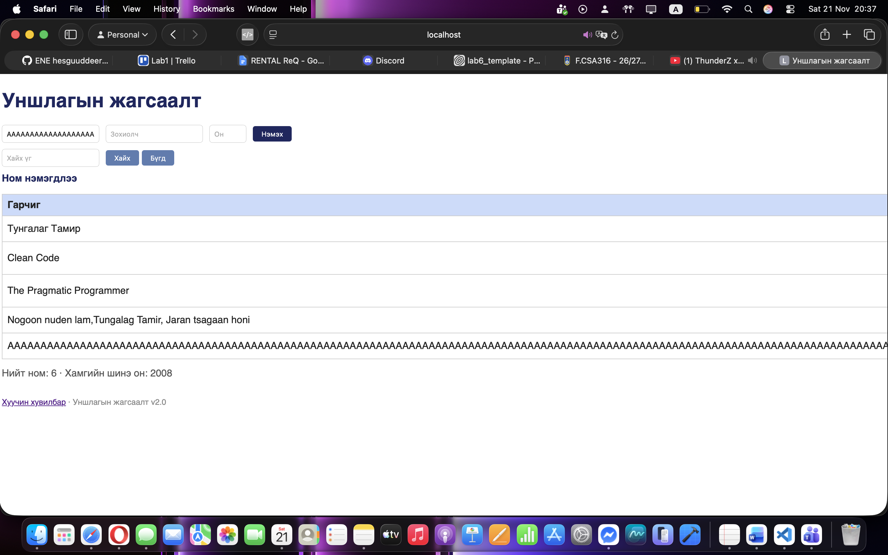
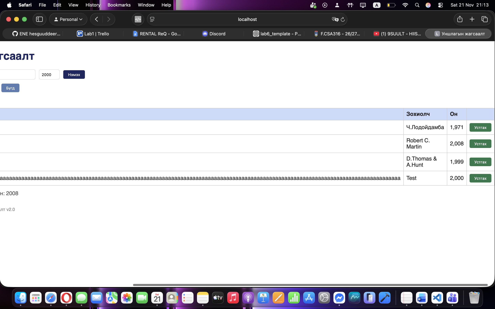

# BUG-09: Хоосон зайгүй урт гарчигтай ном нэмэхэд хүснэгт хуудаснаас хэтэрч, Зохиолч/Он/Устгах баганууд алга болно

Орчин:  Уншлагын жагсаалт v2.0, Safari 26.6.2, macOS 26.6.2, 2026-11-21
Урьдчилсан нөхцөл: `node app.js`-ийг шинээр асаасан (анхны 3 ном: Тунгалаг Тамир, Clean Code, The Pragmatic Programmer)

## Дахин гаргах алхам
1. `http://localhost:3000` нээ.
2. Гарчиг талбарт хоосон зайгүй 300 тэмдэгт оруул (жишээ: терминалд `printf 'A%.0s' $(seq 1 300) | pbcopy` → Cmd+V).
3. Зохиолч = `Test`, Он = `2000` → **Нэмэх**.

Хүлээгдэж байсан: урт гарчиг нүдэнд багтаж (мөр шилжих эсвэл таслагдах), бусад баганууд харагдсан хэвээр — спецификаци: «хүснэгт ямар ч урттай оролтод эвдрэхгүй».
Бодит үр дүн:     гарчиг нэг мөрөнд таслагдалгүй сунаж, хүснэгт хуудасны өргөнөөс хэтэрсэн. Хуудасны агуулга зүүн ирмэг рүү шахагдаж, Зохиолч, Он баганууд болон бүх **Устгах** товч дэлгэцээс гадуур гарсан (bug-09.png). Тэдгээрийг харахын тулд хуудсыг баруун тийш гүйлгэх шаардлагатай бөгөөд гүйлгэхэд хуудасны гарчиг, форм, «Нийт ном» мөр зүүн талаас таслагдана (bug-09-scroll.png).

Ноцтой байдал: Major — нэг урт оролт бүх хуудасны бүтцийг эвдэж, Устгах товч зэрэг гол удирдлагыг харагдахгүй болгоно.
Хавсралт:       
Олдсон аялал:  Couch Potato (хэт урт оролт)
