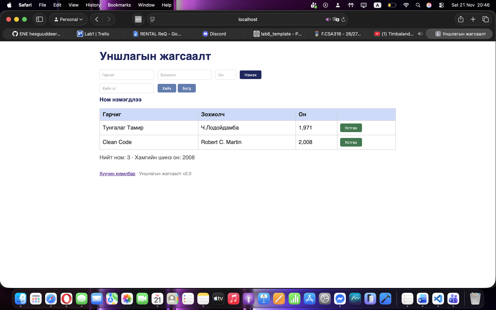

# BUG-10: Ном устгахад «Ном нэмэгдлээ» гэсэн буруу мессеж гарна

Орчин:  Уншлагын жагсаалт v2.0, Safari 26.6.2, macOS 26.6.2, 2026-11-21
Урьдчилсан нөхцөл: `node app.js`-ийг шинээр асаасан (анхны 3 ном: Тунгалаг Тамир, Clean Code, The Pragmatic Programmer)

## Дахин гаргах алхам
1. `http://localhost:3000` нээ (мессеж харагдахгүй байгааг шалга).
2. Юу ч нэмэлгүйгээр **The Pragmatic Programmer** мөрийн **Устгах** дар.

Хүлээгдэж байсан: устгасныг илэрхийлэх мессеж (жишээ нь «Ном устгагдлаа») — спецификаци: «Үйлдэл бүрийн дараах мессеж тухайн үйлдэлдээ тохирно».
Бодит үр дүн:     ном устсан боловч хүснэгтийн дээр «Ном нэмэгдлээ» гэсэн мессеж гарсан.

Ноцтой байдал: Minor — үйлдэл зөв хийгдсэн ч хэрэглэгчийг төөрөгдүүлэх мессеж.
Хавсралт:      
Олдсон аялал:  Fed-Ex
