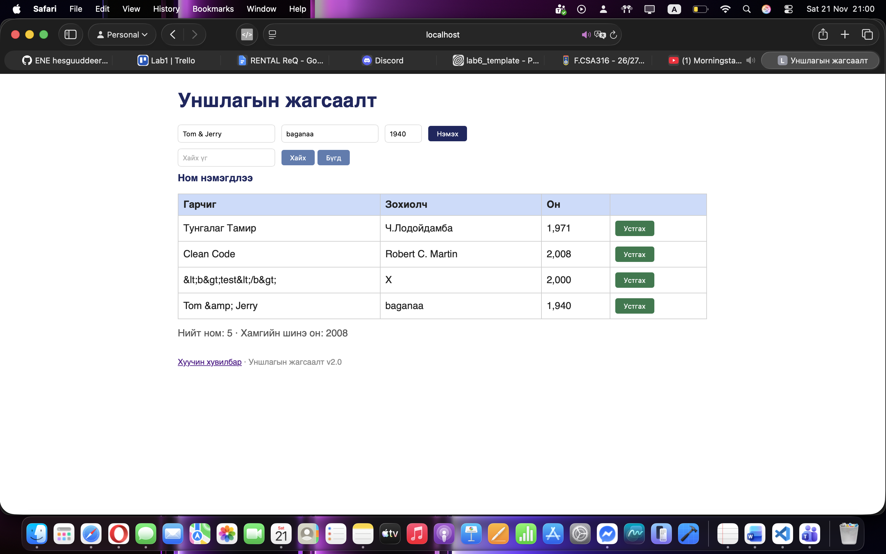
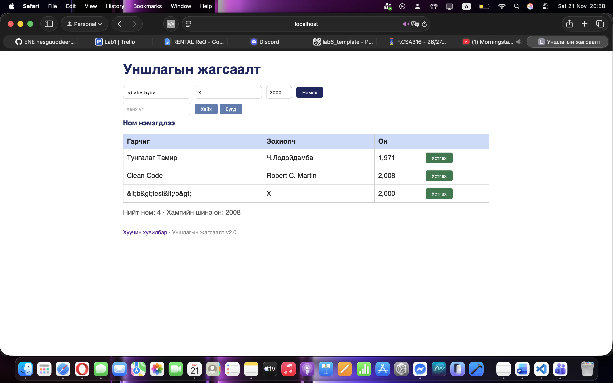

# BUG-11: Гарчиг дахь «&», «<», «>» тэмдэгт «&amp;», «&lt;», «&gt;» болж харагдана

Орчин:  Уншлагын жагсаалт v2.0, Safari 26.6.2, macOS 26.6.2, 2026-11-21
Урьдчилсан нөхцөл: `node app.js`-ийг шинээр асаасан (анхны 3 ном: Тунгалаг Тамир, Clean Code, The Pragmatic Programmer)

## Дахин гаргах алхам
1. `http://localhost:3000` нээ.
2. Гарчиг = `Tom & Jerry`, Зохиолч = `Test`, Он = `1940` → **Нэмэх**.
3. Гарчиг = `<b>test</b>`, Зохиолч = `X`, Он = `2000` → **Нэмэх**.

Хүлээгдэж байсан: хүснэгтэд яг оруулсан текст `Tom & Jerry`, `<b>test</b>` харагдана (эрүүл ухаан: хэрэглэгчийн оруулсан өгөгдөл өөрчлөгдөхгүй).
Бодит үр дүн:     `Tom &amp; Jerry`, `&lt;b&gt;test&lt;/b&gt;` гэж харагдсан — тэмдэгтүүд хоёр удаа escape хийгдсэн. (HTML код ажиллаагүй тул XSS эрсдэл ажиглагдаагүй.)

Ноцтой байдал: Minor — «&» агуулсан энгийн гарчиг ч эвдэрч харагдана.
Хавсралт:       
Олдсон аялал:  Charter-аас гадуур (тусгай тэмдэгтийн туршилт)
